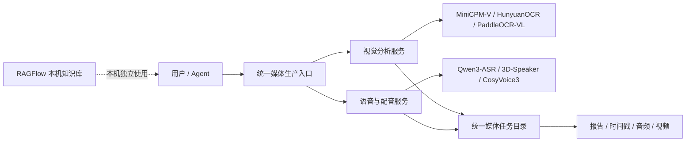

# 媒体生产系统项目总结

统计与规划时间：2026-09-11

## 一、总体结论

两个项目不应该合并成一个大程序。推荐采用“**产品层面统一，处理引擎分开**”的结构：对外展示为一个媒体生产系统，对内由视觉分析服务和语音配音服务独立运行。

这样既能保持展示时的完整性，也能让生产环境按任务类型独立扩容、升级和排错。RAGFlow 属于本机知识库系统，不纳入云端媒体生产系统。

## 二、两个项目的职责

### 1. 语音与配音工作台

项目：野构 Studio 声像制片台（仓库路径由部署环境决定）

负责：

- 音频或视频音轨提取与清洁
- 3D-Speaker 多说话人识别
- Qwen3-ASR 台词识别
- Qwen3-ForcedAligner 时间戳处理
- CosyVoice3 音色克隆和 TTS
- 参考音色资产生成与管理
- 片段试音、目标时长适配和配音结果输出
- 重新配音工作台的时间轴和 TTS 操作界面

当前服务：

- 工作台：`7866`
- 独立 Qwen3-ASR API：`18763`

### 2. 视觉分析工作室

项目：`/mnt/c/Users/Administrator/media-analysis-vision-studio`

负责：

- 视频上传和时间范围选择
- 逐秒高清帧抽取
- 20 秒视觉联系图
- 5 秒细节帧分析
- MiniCPM-V 视觉理解
- 画面、镜头、构图、动作、文字和连续性报告
- 视觉证据索引和可下载输出包

当前模型：MiniCPM-V 4.5 GPTQ 4-bit。

## 三、目前存在的重复

重复主要发生在基础能力和界面层面，两个项目没有直接互相导入，也没有重复保存模型。

| 重复内容 | 当前情况 | 后续处理 |
|---|---|---|
| 视频上传与本地预览 | 两个项目各自实现 | 统一产品入口的上传体验 |
| 时间轴选段 | 两个项目都有 | 统一时间戳数据格式 |
| FFmpeg、时长和媒体信息 | 两边各有一套辅助逻辑 | 后续抽成公共媒体工具包 |
| 任务状态和输出目录 | 两边分别保存 | 统一任务 ID 和输出目录规范 |
| WebUI 启动脚本 | 各自独立 | 由统一部署脚本集中编排 |

视觉项目的时间轴已经连接真实的视觉分析任务；语音项目的 `/studio` 已有选段、参考台词自动识别和片段试音，整段人声分离、逐句批量配音和最终视频回写仍需继续接入后端。

## 四、推荐的产品结构



统一入口只负责接收任务、显示进度、调用服务和组织结果，不把所有模型塞进同一个 Python 进程。

## 五、展示版与生产版

### 展示版

展示时使用一个产品名称和一个入口页面，页面内提供两个模块：

1. “视觉分析”：上传视频，生成带证据的导演拉片报告。
2. “声音与配音”：识别说话人、建立音色资产、选择片段并重新配音。

两个引擎仍然使用独立容器，入口页面只负责跳转或调用 API。这样演示路径清楚，也不会因为某个大模型正在加载而拖垮整个界面。

### 生产版

生产环境使用独立服务：

- 视觉服务独立部署 MiniCPM-V 和 OCR 模型。
- 语音服务独立部署 ASR、说话人识别和 CosyVoice。
- 每个任务有唯一 `job_id`，输入、处理中间文件和结果都落在持久化目录。
- 视觉和语音可以分别配置 GPU、并发数和重启策略。
- 统一入口通过 HTTP API 调度，不直接依赖另一个项目的内部 Python 模块。

## 六、统一数据格式

两个项目后续应共享以下任务记录结构：

```json
{
  "job_id": "任务唯一编号",
  "source": "原始媒体路径或对象存储地址",
  "duration_sec": 0,
  "segments": [
    {
      "start_sec": 0.0,
      "end_sec": 2.5,
      "speaker_id": "speaker_a",
      "transcript": "台词文本",
      "visual_report": "关联的视觉分析文件"
    }
  ],
  "outputs": {
    "visual_report": "视觉报告路径",
    "transcript": "带时间戳台词路径",
    "dubbed_audio": "配音音频路径",
    "dubbed_video": "最终视频路径"
  }
}
```

统一格式可以让 Agent 根据同一个任务记录继续执行分析、修改台词、生成配音和合成视频。

## 七、云端迁移范围

云端只部署媒体生产链路：

- 野构 Studio 声像制片台的 ASR、CosyVoice 和时间戳功能
- `media-analysis-vision-studio` 的 MiniCPM-V 视觉分析
- HunyuanOCR 和 PaddleOCR-VL（需要时再启用）
- 独立的输入、输出和模型数据盘

云端不部署：

- RAGFlow
- MySQL、Elasticsearch、MinIO、Valkey
- Qwen3-Embedding 两个版本
- 本机知识库和 `G:\\天涯` 文章库

估算：

- ASR + CosyVoice：约 74.5GB，建议 150GB SSD。
- 加入视觉和 OCR：约 136.4GB，建议 250GB 起步，长期使用建议 300GB 以上。

## 八、模型和显存策略

- 16GB 显存适合 ASR、TTS、视觉模型串行运行。
- 24GB 显存更适合单 GPU 测试和较少并发。
- 追求速度时，视觉服务与语音服务使用不同 GPU。
- 模型权重放在 `/data/models`，不写入 Docker 镜像层。
- CosyVoice 与 Qwen3-ASR 保持独立进程，避免 Transformers 版本冲突。

## 九、落地顺序

1. 保持两个 Git 项目独立，先统一 README、端口和路径说明。
2. 统一任务记录、时间戳和输出目录格式。
3. 把视觉分析能力接入语音工作台的统一入口。
4. 将 `/studio` 的人声/环境声分离、逐句批量 TTS 和视频回写接入真实后端。
5. 增加统一任务调度、进度查询和失败重试。
6. 本机作为知识库节点，云端作为媒体处理节点。
7. 最后再制作统一展示首页或反向代理入口。

## 十、最终定位

这是一个由两个专业引擎组成的媒体生产系统：

- 视觉引擎回答“画面发生了什么”。
- 语音引擎回答“谁在说话、说了什么，以及如何重新配音”。
- 统一入口负责把两个结果串成可执行的生产流程。
- RAGFlow 留在本机，继续承担文章知识库和检索工作。
